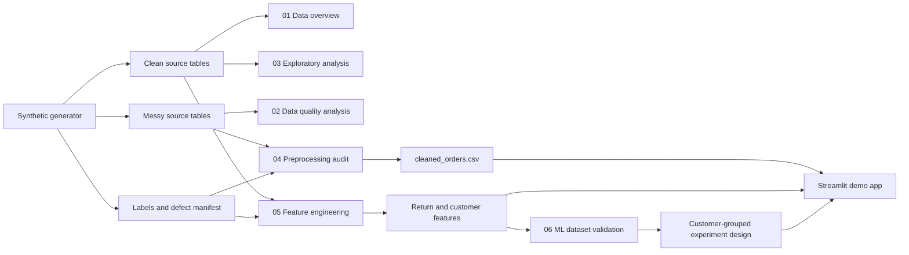

# EcomPolice

EcomPolice is a synthetic e-commerce return analytics project built for academic demonstration. It takes fictional Indian e-commerce data through generation, quality auditing, preprocessing, exploratory analysis, leakage-aware feature engineering, and ML experiment design.

> Synthetic-only project. Simulated scenario labels are not verified fraud labels, and a returned order is not automatically suspicious.

## What is included

- Synthetic customers, products, orders, deliveries, returns, labels, and controlled defects
- Six teacher-ready Jupyter notebooks
- A reproducible preprocessing and feature-engineering pipeline
- Dataset validation and a customer-grouped ML experiment plan
- A local Streamlit presentation dashboard
- Automated tests and audit reports

## Workflow



## Run the presentation app

```bash
python -m venv .venv
source .venv/bin/activate       # Windows: .venv\Scripts\Activate.ps1
python -m pip install -r requirements.txt
streamlit run app.py
```

The app presents the project overview, data-quality evidence, EDA, engineered features, and ML experiment design. It is read-only: it does not train a model or make fraud decisions.

## Notebook order

| # | Notebook | Focus |
|---:|---|---|
| 1 | [01_synthetic_data_overview.ipynb](notebooks/synthetic_pipeline/01_synthetic_data_overview.ipynb) | Entities, schemas, IDs, and synthetic-data limitations |
| 2 | [02_data_quality_analysis.ipynb](notebooks/synthetic_pipeline/02_data_quality_analysis.ipynb) | Controlled defects in messy data |
| 3 | [03_exploratory_data_analysis.ipynb](notebooks/synthetic_pipeline/03_exploratory_data_analysis.ipynb) | Customer, order, delivery, and return patterns |
| 4 | [04_data_preprocessing.ipynb](notebooks/synthetic_pipeline/04_data_preprocessing.ipynb) | Conservative cleaning, flags, joins, and before/after evidence |
| 5 | [05_feature_engineering_and_model_ready_data.ipynb](notebooks/synthetic_pipeline/05_feature_engineering_and_model_ready_data.ipynb) | Chronological customer-history features |
| 6 | [06_ml_dataset_validation.ipynb](notebooks/ml/06_ml_dataset_validation.ipynb) | Feature validation and grouped experiment design |

In VS Code, install the Python and Jupyter extensions, select the `.venv` interpreter as the notebook kernel, then run the notebooks top to bottom.

## Project structure

```text
app.py                         Streamlit presentation application
notebooks/                     Academic notebook series
data/synthetic/clean/          Valid generator output
data/synthetic/messy/          Controlled defective copies
data/synthetic/labels/         Separate generator-defined labels
data/synthetic/manifests/      Defect manifest and data dictionary
data/processed/                Derived cleaned, feature, target, and split files
reports/                       Audit, validation, and experiment reports
scripts/                       Reproducible pipeline entry points
tests/                         Automated validation tests
archive/kaggle_workflow/       Preserved but inactive legacy material
```

## Rebuild derived outputs

Source tables are preserved. These commands recreate only derived outputs and reports:

```bash
PYTHONPATH=src python scripts/run_preprocessing_audit.py
PYTHONPATH=src python scripts/run_feature_engineering.py
PYTHONPATH=src python scripts/run_ml_dataset_validation.py
```

Regenerate the synthetic source data only if you deliberately want a new dataset:

```bash
PYTHONPATH=src python -m synthetic_data.run
```

## Main outputs

| Output | Purpose |
|---|---|
| `cleaned_orders.csv` | One-row-per-order analytical dataset with quality flags |
| `return_level_features.csv` | Features available at return-request time |
| `customer_level_features.csv` | Customer-level historical summary |
| `return_level_targets.csv` | Separate simulated targets aligned by stable IDs |
| `return_level_split_assignments.csv` | Reproducible customer-grouped train/validation/test split |
| `preprocessing_audit_report.md` | Before/after cleaning evidence |
| `feature_engineering_report.md` | Prediction point and feature logic |
| `ml_dataset_validation_report.md` | Dataset diagnostics and limitations |
| `ml_experiment_design.md` | Leakage-safe future modelling plan |

## Validation

```bash
PYTHONPATH=src python -m unittest discover -s tests
```

The test suite covers IDs, foreign keys, chronology, controlled defects, duplicate handling, one-row-per-order output, historical feature calculations, target separation, and grouped splitting.

## Important limitations

- All data, labels, and patterns are generated assumptions for classroom use.
- Scenario labels stay outside feature inputs.
- Historical features use only information available before each return request.
- No model is trained, evaluated, deployed, or used to label real customers.
- The archived Kaggle workflow is preserved only for reference and is not part of the active project.
